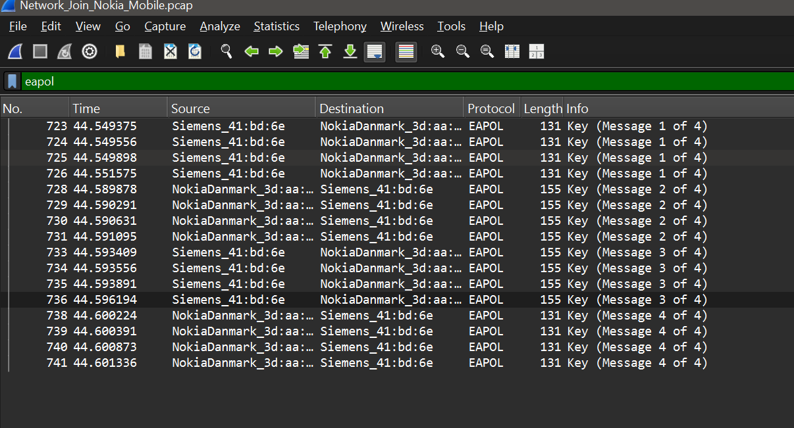
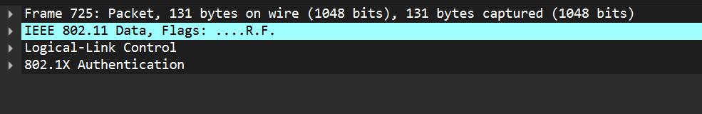
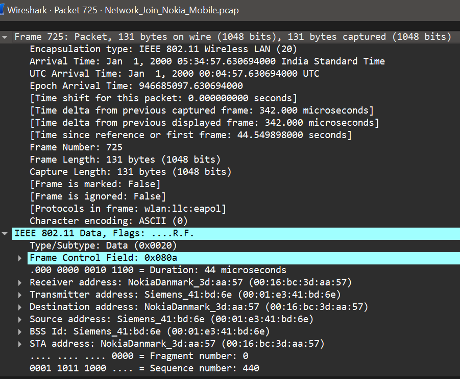
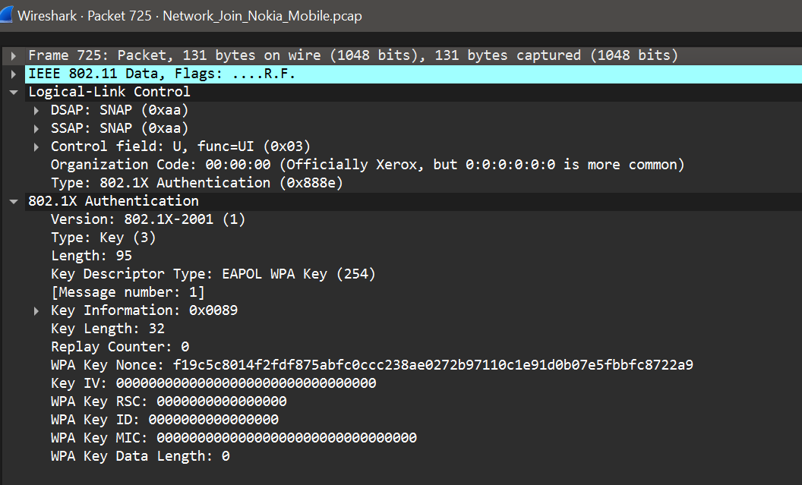

# Experiment 7: Analyze WPA-2 Security and Capture the Handshake with Wireshark

## Aim
To inspect a WPA2 four-way handshake in a Wireshark packet capture and identify its EAPOL key messages.

## Theory
WPA2 protects a wireless network by establishing encryption keys between an access point and a client. After a client begins joining the network, the devices exchange a four-message handshake using EAPOL (Extensible Authentication Protocol over LAN). The exchange confirms that both sides can derive the required keys without transmitting the Wi-Fi passphrase in clear text.

The four messages have distinct roles:
- **Message 1:** The access point sends a nonce to the client.
- **Message 2:** The client responds with its nonce and a message integrity code.
- **Message 3:** The access point confirms key installation and provides key information.
- **Message 4:** The client acknowledges the exchange.

The handshake is used to establish session keys; seeing it in a capture does not reveal the passphrase.

## Tools Used
- Wireshark
- A packet capture containing an authorized WPA2 client connection

## Methodology
1. Open the authorized wireless packet capture in Wireshark.
2. Filter the packet list for EAPOL traffic.
3. Identify the EAPOL key packets and inspect the message numbers in the **Info** column.
4. Select a packet and expand the IEEE 802.1X Authentication details to review the key message fields.
5. Compare the packet list and decoded packet details to confirm the handshake sequence.

Only capture or inspect wireless traffic on networks and devices for which you have permission.

## Screenshots

### 1. EAPOL handshake messages
The packet list shows EAPOL key packets identified as messages 1 through 4 of the handshake.

### 2. Selected packet and 802.1X details
The selected frame is decoded as IEEE 802.11 data carrying 802.1X authentication. The packet details show the EAPOL WPA key descriptor and identify the selected packet as message 1.

### 3. Packet protocol layers
The packet details pane shows the protocol layers for the selected frame, including IEEE 802.11 data, Logical-Link Control, and 802.1X Authentication.

### 4. Frame and wireless address fields
The expanded frame and IEEE 802.11 sections show the captured frame metadata and wireless address fields for the selected packet.

## Observations
- Wireshark decoded the exchange as EAPOL WPA key traffic.
- The packet list displayed the four key-message numbers.
- The selected packet details exposed handshake metadata, including the key descriptor and message number.
- The frame details showed the 802.11 data frame and its source, destination, and BSSID fields.

## Result
The WPA2 EAPOL four-way handshake was identified and examined in Wireshark. Its key messages and decoded packet structure were observed.

## Improvements
- Capture a complete connection attempt from an authorized test client, then annotate the four EAPOL messages with their sender, purpose, and important key fields.
- Include a Wireshark display-filter example such as `eapol` and record the capture interface and test setup so the analysis can be repeated.
- Compare authorized WPA2 captures from different client or access-point configurations and note any differences in handshake fields.
- Add a brief security note explaining that the handshake establishes session keys but does not expose the passphrase in clear text; keep packet captures restricted to the lab.

## Conclusion
This experiment demonstrated how Wireshark can be used to analyze the EAPOL key exchange associated with a WPA2 connection. The four-message handshake establishes session keys between the client and access point; it does not transmit the network passphrase in clear text.
